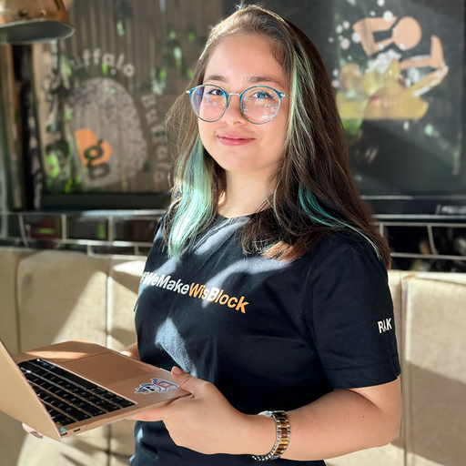

<!-- ================= HERO ================= -->

<div align="center">


<br/>



# Hey, I'm Kelly! 👩🏻‍💻

### System Engineer · Content Engineer · Educator · Community Builder

📍 Barranquilla, Colombia 🇨🇴

[](https://github.com/02KellyDev)
[](https://linkedin.com/in/02kellyv)
[](https://medium.com/@02KellyV)
[](https://caribedev.org)

</div>

---

<!-- ================= ABOUT ME ================= -->

## 🧬 About me

```javascript
const kelly = {
  name: "Kelly Villa",
  alias: "02KellyV",
  location: "Barranquilla, Colombia 🇨🇴",

  roles: [
    "Software Engineer",
    "Content Engineer @ MeltStudio",
    "Professor @ Universidad de la Costa",
    "Founder & Developer @ CaribeDev"
  ],

  communities: [
    "CaribeDev",
    "PionerasDev",
    "Women Techmakers"
  ],

  interests: [
    "Software Architecture",
    "Developer Experience",
    "Cloud Computing",
    "Tech Communities",
    "Education",
    "Open Source"
  ],

  currently: "Building, teaching & connecting people through tech",

  funFact: "I believe technology grows faster when knowledge is shared."
};
```

I build digital products, create technical content and help developers grow through education and community building.

I'm passionate about making technology more accessible, connecting
people with opportunities and creating spaces where developers can learn,
collaborate and build things together.

---

## 🌎 Opportunities & Community

<div align="center">

### 🚀 Looking for your next opportunity?

**We're building things and looking for people who want to build with us!**

</div>

<table>
<tr>
<td width="50%" align="center">

### 💼 Join MeltStudio

Looking for a new challenge in software development?

At MeltStudio, we build digital products and SaaS solutions
for startups around the world.

We're always looking for talented people from Latin America.

<a href="https://www.meltstudio.co/jobs">

</a>

</td>
<td width="50%" align="center">

### 🌴 Join CaribeDev

Are you a developer, student or tech enthusiast from the
Colombian Caribbean?

Meet the community, discover free events, share knowledge
and connect with other people in tech.

<a href="https://caribedev.org/">

</a>

</td>
</tr>
</table>

**Good things happen when people connect. Come build with us! 💜**

---


## 💼 What I do

<table>
<tr>
<td width="50%">

### 🚀 MeltStudio

**Content Engineer**

Working with a team building digital products and SaaS solutions
for startups.

I combine software development, technical communication and
developer-focused content.

[Explore MeltStudio](https://www.meltstudio.co/)

</td>
<td width="50%">

### 🎓 Universidad de la Costa

**Professor · CUC**

Teaching:

- Software Engineering
- Algorithms & Programming
- Good Software Development Practices

Helping future developers understand how software is designed,
built and delivered.

[Visit CUC](https://www.cuc.edu.co/)

</td>
</tr>
<tr>
<td width="50%">

### 🌴 CaribeDev

**Founder & Developer**

Building a community that connects developers, students,
universities and technology communities across the Colombian Caribbean.

Free tech events, knowledge sharing and opportunities for everyone.

[caribedev.org](https://caribedev.org/)

</td>
<td width="50%">

### 🧡 PionerasDev

**Community Leader**

Supporting women in technology since 2018.

Promoting learning, visibility, professional development and
opportunities for women developers.

</td>
</tr>
</table>

---

## 🏆 Achievements & Community

- 🧡 Women Techmakers Ambassador (2024).
- 🌱 PionerasDev community member and leader since 2018.
- 🌴 Founder and developer at CaribeDev since 2023.
- 🎤 Community building and technical event organization.
- 🚀 Co-creator of CaribeConf, bringing the Caribbean tech ecosystem together.
- 🎓 Technical educator creating free learning resources.
- 🌎 Advocate IEEE for accessible technology education in Latin America.

> "The best way to learn technology is to build things, share what you
> know and help someone else get started."

---

## 📚 Knowledge Base & Developer Workshops

I create practical documentation and learning resources for developers
and students. Here are some of my workshops:

<table>
<tr>
<td width="50%" valign="top">

### ☁️ AWS Workshop

<a href="https://kelly-hecate-villa.gitbook.io/aws-workshop/">

</a>

AWS fundamentals, EC2, infrastructure and cloud deployment.

</td>
<td width="50%" valign="top">

### 🔥 Angular Workshop

<a href="https://kelly-hecate-villa.gitbook.io/angular-workshop/">

</a>

Angular, Firebase, Firestore and application development.

</td>
</tr>
<tr>
<td width="50%" valign="top">

### 🚀 Netlify Workshop

<a href="https://kelly-hecate-villa.gitbook.io/netlify-workshop-cuc">

</a>

Continuous deployment and publishing web applications.

</td>
<td width="50%" valign="top">

### 🐙 GitHub Profile Workshop

<a href="https://kelly-hecate-villa.gitbook.io/github-profile-readme-cuc/">

</a>

Git, GitHub, README profiles and developer workflows.

</td>
</tr>
</table>

---

## ✍️ Writing & Technical Content

I enjoy documenting what I learn and sharing technical knowledge.

| Publication | What you'll find |
|---|---|
| [📝 My Medium](https://medium.com/@02KellyV) | Personal insights, technology and development |
| [🚀 MeltStudio Blog](https://www.meltstudio.co/blog) | Technical guides, software development, tutorials and engineering |

[](https://medium.com/@02KellyV)
[](https://www.meltstudio.co/blog)

---

## 🛠️ Tech Stack & Tools

### Languages & Development


### Cloud & Infrastructure


### Databases & Tools


---

<!-- ================= GITHUB STATS ================= -->

## 📊 GitHub Analytics

<div align="center">


<br/>


<br/>


</div>

---

## 🧠 WakaTime · Developer Metrics

<!--START_SECTION:waka-->

<!--END_SECTION:waka-->

---

## 👩🏻‍🏫 A little advice for my students

If you're visiting my GitHub, welcome! 👀 Here are a few things I want you to remember:

> 💡 **Don't just learn syntax. Learn how to solve problems.**

> 🧩 Break big problems into smaller problems. That's software engineering.

> 🐛 Debugging is not failure. It's part of the job.

> 📖 Read documentation. Google is useful, but understanding is better.

> 🌱 Your first project doesn't need to be perfect. It needs to exist.

> 🤖 AI can help you write code, but you must be able to explain,
> understand, test and maintain what you deliver.

> 🚀 Build a portfolio. Your GitHub is part of your professional story.

**My challenge for you:** Build something, document it, share it and
improve it. Repeat.

---

## 🐍 My GitHub Contributions

<div align="center">


</div>

---

## 💬 Random Dev Quote

<div align="center">


</div>

---

<div align="center">

### Thanks for visiting my little corner of GitHub! 💜

**Build things. Share knowledge. Create opportunities.**


</div>
